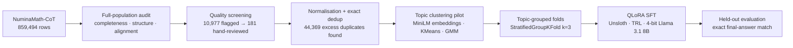
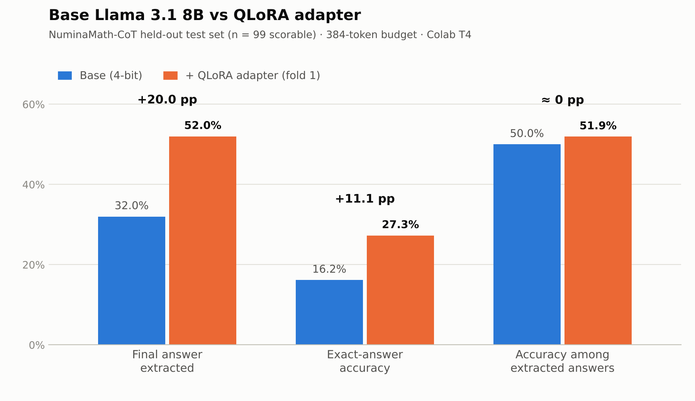

# llama3-8b-qlora-math-t4

**QLoRA fine-tuning of Llama 3.1 8B Instruct for maths problem solving, on a single free Colab T4 GPU.**

Under a fixed 384-token generation budget, a LoRA adapter training **0.52% of the model's parameters** raised final-answer completion from **32% → 52%** and exact-answer accuracy from **16.2% → 27.3%** on held-out NuminaMath-CoT problems (n = 99).

> **Status:** v1, a hands-on learning experiment. The results are real, the limitations are listed openly below, and v2 fixes are planned.

---

## The question behind this project

Most fine-tuning tutorials assume an A100. This one asks a narrower, practical question:

> *What can supervised fine-tuning realistically change in an 8B model when you only have ~15 GB of GPU memory and a tight token budget?*

That constraint matters for real deployments: low-memory devices, cheap inference, and latency-bound applications where a model has to **finish its answer within a fixed number of tokens**.

---

## Results

| Metric (100 held-out test problems) | Base Llama 3.1 8B | + QLoRA adapter | Change |
|---|---:|---:|---:|
| Final answer extracted (`\boxed{}`) | 32% | **52%** | +20 pp |
| Exact-answer accuracy (n = 99 scorable) | 16.16% | **27.27%** | **+11.11 pp** |
| Accuracy among extracted answers | 50.0% (16/32) | 51.9% (27/52) | ≈ 0 |
| Numeric pairs scored | 22 | 31 | +9 |
| Numeric MAE | 13.68 | 154.73 | worse |

**How to read this honestly**

- The pre-registered success criterion (≥ +5 pp exact-answer accuracy) was met.
- Accuracy *among answers the model actually finished* barely moved. Most of the gain comes from the adapter learning to **produce a complete, boxed final answer inside the 384-token cap**, while the base model was often cut off mid-derivation.
- So the claim this experiment supports is **"more completed answers under a tight token budget"**, not "stronger mathematical reasoning". Testing the second claim needs a higher-budget run (see *Limitations*).

---

## Pipeline

### 1. Dataset audit: [AI-MO/NuminaMath-CoT](https://huggingface.co/datasets/AI-MO/NuminaMath-CoT)

Every check below ran over **all 859,494 training rows**, not a sample.

- **Completeness:** 0 missing keys, nulls, wrong types or empty strings across `source`, `problem`, `solution` and `messages`.
- **Conversation structure:** 100% of rows are exactly two turns (user → assistant), with no malformed roles or content.
- **Field alignment:** `problem` and `solution` match the `messages` turns exactly in 100% of rows.
- **Source mix:** cn_k12 32.2%, synthetic_math 19.5%, orca_math 17.8%, olympiads 17.5%, synthetic_amc 7.2%, aops_forum 3.5%, MATH 0.9%, GSM8K 0.9%, AMC/AIME 0.5%.
- **Answer format** (5k-row sample): 99.98% of solutions use LaTeX and 97.3% end in a `\boxed{}` answer. This is why `\boxed{}` extraction is the evaluation target.

### 2. Quality screening and manual adjudication

- Regex and heuristic screens flagged **10,977 rows (1.28%)**: problems with no maths cues, very short problems or solutions, identical problem/solution pairs, and refusal-style phrases.
- **181 high-priority rows** were reviewed by hand and logged in an adjudication register (`KEEP` / `EXCLUDE` / `CORRECT` / `PENDING`):
  - All 10 "refusal" flags turned out to be **false positives**: phrases like *"I do not know"* that belong to the puzzle itself, not to an AI refusal.
  - At least one logic-puzzle solution was **brute-force verified in code** and corrected.
  - Final register: 162 keep, 13 exclude, 3 corrected, 3 pending.

### 3. Normalisation and deduplication

- Unicode NFC, newline and whitespace normalisation changed 17,222 problem strings.
- Exact matching on normalised problem keys:
  - 815,125 unique problems
  - 25,874 duplicate groups covering 70,243 rows, i.e. **44,369 excess records**
  - 22,194 of those groups have *multiple different solutions* for the same problem
  - 3,861 groups are identical problem–solution pairs (6,841 excess copies)

### 4. Topic structure (1,000-problem pilot)

- `all-MiniLM-L6-v2` sentence embeddings (384-d, L2-normalised).
- MiniBatchKMeans (k = 10): silhouette score **0.074**. Maths topics overlap heavily in a general-purpose embedding space.
- A diagonal-covariance Gaussian mixture model exposed **3 zero-variance embedding dimensions** (127, 223, 319), which were removed. KMeans vs GMM agreement: ARI 0.389, NMI 0.568.
- Clusters were used as **groups** in `StratifiedGroupKFold`, so each validation fold holds out whole topic clusters.

### 5. QLoRA supervised fine-tuning

| Setting | Value |
|---|---|
| Base model | `unsloth/Llama-3.1-8B-Instruct-bnb-4bit` (4-bit NF4) |
| Framework | Unsloth + TRL `SFTTrainer` + PEFT |
| LoRA rank / alpha / dropout | 16 / 16 / 0 |
| Target modules | `q, k, v, o, gate, up, down` projections |
| Trainable parameters | 41,943,040 of 8.07B (**0.52%**) |
| Max sequence length | 2,048 (longer examples **filtered out**, not truncated) |
| Optimiser | AdamW 8-bit, lr 2e-4, cosine schedule, weight decay 0.01, grad-norm clip 0.3 |
| Batch | 1 × gradient accumulation 8 = effective batch 8 |
| Steps | 200 per fold (~2.3 epochs on fold 1's 698 examples) |
| Gradient checkpointing | Unsloth |
| Data format | Prompt–completion chat template with a system instruction |
| Leakage guard | All 100 test problems excluded from training by normalised-problem key |

The evaluated adapter is **fold 1** (698 training examples).

### 6. Evaluation

- **Test set:** the official 100-problem NuminaMath-CoT test split; 99 have an extractable reference answer.
- **Generation budget:** `max_new_tokens = 384` for both models.
- **Scoring:** the final `\boxed{}` answer is extracted with a brace-depth parser. Numeric answers use `math.isclose` (rel 1e-6, abs 1e-8); symbolic answers use a strict normalised string match.

---

## Hardware and memory budget

Everything runs on a free **Colab Tesla T4 (14.56 GB usable)**, which is the defining constraint of this project.

| Component | Approx. memory |
|---|---:|
| 4-bit Llama 3.1 8B (embeddings and LM head stay in 16-bit) | ~5.7 GB |
| CUDA context | ~0.4–0.5 GB |
| KV cache, at 2 × 32 layers × 8 KV heads × 128 dim × 2 B = **128 KiB/token** | ~0.08 GB at 684 tokens, ~0.17 GB at 1,324 |
| Prefill logits (~300 prompt tokens × 128,256 vocab × fp32) | ~0.15 GB |

---

## Limitations

- **Small, single-run test:** n = 99 with no significance test. A rough unpaired 95% CI for the gain is about −0.3 to +22.5 pp, and a paired McNemar test is the right next check.
- **Token-budget effect:** the gain is mostly answer *completion* under 384 tokens (see Results).
- **Curation not yet applied to training:** the adjudication and dedup outputs are documented but were not yet used to filter the training stream. Training used empty-row, test-leakage and length filters only.
- **Numeric error got worse** (MAE 13.7 → 154.7), so a few large misses dominate.
- **Not tested:** regression on easier problems, and full-population semantic deduplication (an 858k × 858k similarity matrix is not feasible on a T4).

---

## Reproduce

1. Open `LLM_Finetuning.ipynb` in Google Colab and select a **T4 GPU** runtime.
2. Run the cells in order: install → audit → dedup → clustering → base evaluation → QLoRA training → fine-tuned evaluation.
3. To avoid out-of-memory errors, **restart the runtime between base evaluation, training and fine-tuned evaluation**.

**Environment used:** Python 3.13 · PyTorch 2.11 (CUDA 13.0) · Transformers 5.17 · Unsloth 2026.10.7 · TRL · PEFT · sentence-transformers · scikit-learn

## References

- Dettmers et al. (2023). *QLoRA: Efficient Finetuning of Quantized LLMs.* [arXiv:2305.14314](https://arxiv.org/abs/2305.14314)
- Hu et al. (2021). *LoRA: Low-Rank Adaptation of Large Language Models.* [arXiv:2106.09685](https://arxiv.org/abs/2106.09685)
- AI@Meta (2024). *The Llama 3 Herd of Models.* [arXiv:2407.21783](https://arxiv.org/abs/2407.21783)
- [AI-MO/NuminaMath-CoT](https://huggingface.co/datasets/AI-MO/NuminaMath-CoT) dataset
- [Unsloth](https://github.com/unslothai/unsloth)

## Licence note

The base model is subject to the [Llama 3.1 Community License](https://www.llama.com/llama3_1/license/). Any adapter or derived model released from this repo must follow its terms, including naming derivatives with a "Llama" prefix.

---

## Base vs fine-tuned comparison

<picture>
  <source media="(prefers-color-scheme: dark)" srcset="base_vs_qlora_dark.png">
  
</picture>

| Metric | Base | + QLoRA | Change |
|---|---:|---:|---:|
| Final answer extracted | 32.0% | 52.0% | +20.0 pp |
| Exact-answer accuracy | 16.2% | 27.3% | +11.1 pp |
| Accuracy among extracted answers | 50.0% | 51.9% | ≈ 0 pp |

The first two pairs show the headline gain. The third pair shows where it comes from: once an answer is completed, both models are right about half the time. The adapter's advantage is finishing more answers inside the 384-token budget.

Chart source: [`make_chart.py`](make_chart.py)

---

**Author:** Thiruvel A P · [GitHub](https://github.com/Thiruvel-AP) · [LinkedIn](https://www.linkedin.com/in/thiruvel-a-p/)